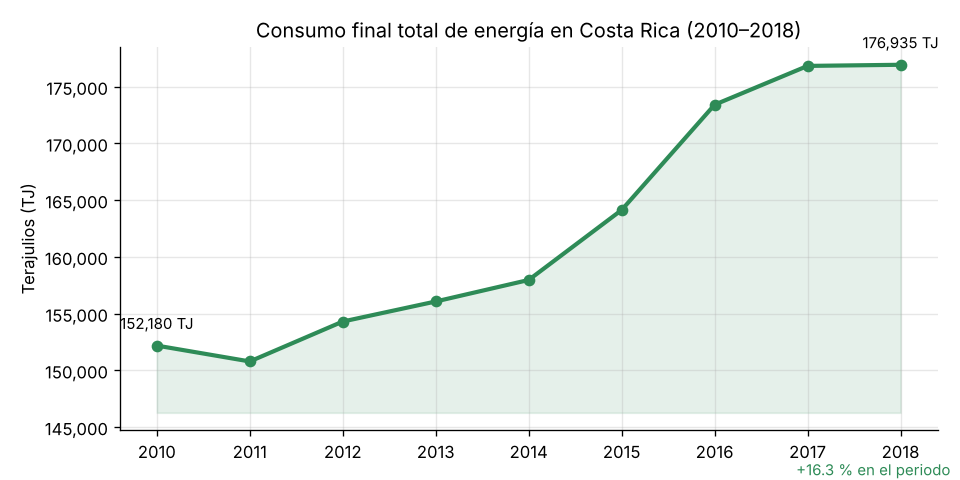
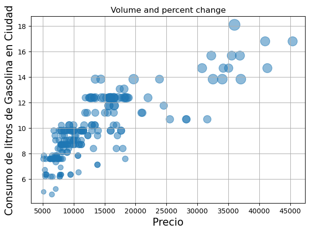

# 📊 Análisis de Datos con Python — Proyectos de curso (2022)

Proyectos que hice en el curso de **Análisis de Datos de la Universidad Castro Carazo** (segundo cuatrimestre de 2022). En ambos apliqué el mismo proceso, de principio a fin: limpieza, transformación, análisis y visualización de datos reales para responder una **pregunta de negocio**.

## Proyectos

| | Proyecto | Pregunta de negocio | Datos |
|---|---|---|---|
| ⚡ | **[Energías renovables en Costa Rica (2010–2018)](energias-renovables-costa-rica)**<br>*Proyecto final* | ¿Cómo impactar positivamente el cambio climático a partir de las energías que produce Costa Rica? | SINAMECC (datos abiertos del gobierno de Costa Rica) |
| 🚗 | **[Autos de segunda mano](autos-segunda-mano)** | ¿Cómo incrementar las ventas de autos usados de la empresa PK2? | UCI Machine Learning Repository |

<p>
  
  
</p>

## Metodología

Los dos proyectos siguen las etapas de la metodología **CRISP-DM**, que vimos en el curso:

1. **Carga y unión de datos:** desde Excel o CSV a un solo DataFrame.
2. **Manejo de valores faltantes:** detección, imputación con media o moda, y eliminación.
3. **Estandarización:** tipos de datos, conversión de unidades y normalización.
4. **Binning:** agrupación de variables numéricas en categorías (bajo, medio y alto).
5. **Visualización y conclusiones:** gráficos que responden la pregunta de negocio.

## Habilidades aplicadas

`Python` · `pandas` · `NumPy` · `matplotlib` · `Jupyter Notebook` · Limpieza de datos · Estadística descriptiva · Visualización · Storytelling con datos

## Cómo abrir los notebooks

- **Para solo verlos:** haz clic en cualquier archivo `.ipynb` y GitHub lo muestra con todos los resultados y gráficos.
- **Para ejecutarlos:**

```bash
pip install pandas numpy matplotlib openpyxl jupyter
jupyter notebook
```

---

Más proyectos en mi perfil: **[github.com/Emendez100](https://github.com/Emendez100)**
