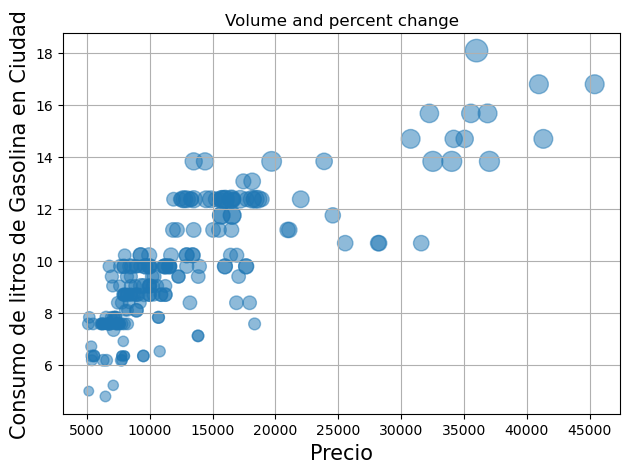
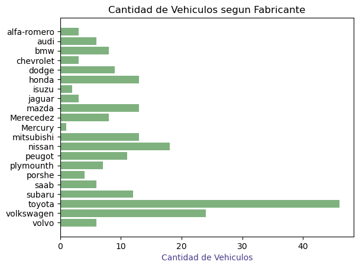
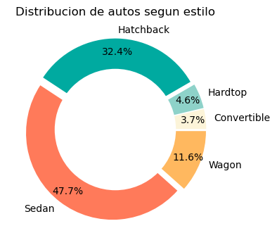

# 🚗 Análisis de autos de segunda mano

Proyecto del curso de Análisis de Datos de la Universidad Castro Carazo (2C-2022). Es un caso de estudio para **PK2**, una empresa de venta de autos usados.

## Pregunta de negocio

> **¿Cómo se pueden incrementar las ventas de autos de segunda mano?**

El análisis da información para tomar decisiones sobre el inventario: cómo se distribuyen los lotes de venta, qué autos tienen mayor precio y qué características tienen.

## Datos

- **Fuente:** [UCI Machine Learning Repository – Automobile](https://archive.ics.uci.edu/ml/datasets/Automobile), un conjunto de datos público.
- **Contenido:** 226 registros en dos archivos, con 26 características: marca, combustible, puertas, estilo, dimensiones, motor, potencia, consumo en ciudad y carretera, y precio. Los archivos están en [`datos/`](datos).

## Proceso

| Etapa | Qué se hizo |
|---|---|
| **1. Carga** | Importación de los dos CSV con `pandas` y unión en un solo DataFrame. |
| **2. Valores faltantes** | Conversión de `?` a `NaN`, imputación con la **media** (numéricos) y la **moda** (texto), y eliminación de los autos sin precio u otros datos clave. Quedaron **216 autos**. |
| **3. Estandarización** | Corrección de tipos de datos y conversión del consumo de **millas por galón a litros por cada 100 km**. Normalización de largo, ancho y alto. |
| **4. Binning** | Clasificación de los autos por **potencia** (caballos de fuerza) en bajo, medio y alto. |
| **5. Visualización** | Gráficos por fabricante, estilo, puertas y potencia, y relación entre precio y consumo. |

## Hallazgos

- **Inventario concentrado:** Toyota es la marca con más autos (46), seguida de Volkswagen (24) y Nissan (18).
- **Estilos:** los sedán (47.7 %) y hatchback (32.4 %) son casi el 80 % del inventario.
- **Potencia:** la mayoría son de potencia baja (169 de 216). Muy pocos son de potencia alta.
- **Precio y consumo:** los autos más caros **consumen más combustible** (correlación de 0.81 entre el precio y los litros por cada 100 km).
- **Recomendación para PK2:** enfocar la oferta en sedán y hatchback económicos y de bajo consumo, que son la mayor parte del inventario y lo más buscado en el mercado de usados. Los autos de mayor precio requieren una estrategia aparte, porque su alto consumo es una desventaja.

| Autos por fabricante | Autos por estilo |
|---|---|
|  |  |

## Archivos

| Archivo | Contenido |
|---|---|
| [`analisis_autos_segunda_mano.ipynb`](analisis_autos_segunda_mano.ipynb) | Notebook completo, con código, tablas y gráficos. |
| [`datos/`](datos) | Los dos archivos CSV originales. |
| [`graficos/`](graficos) | Gráficos principales. |

**Herramientas:** Python · pandas · NumPy · matplotlib · Jupyter Notebook
