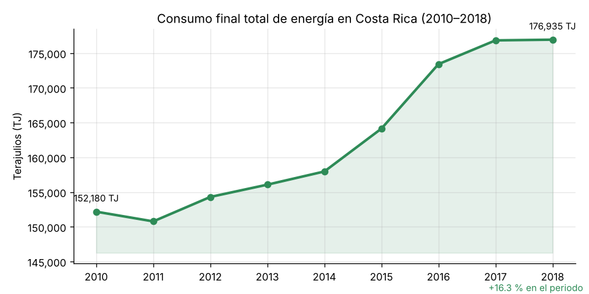
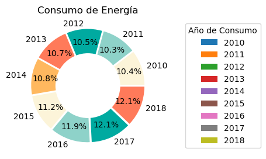
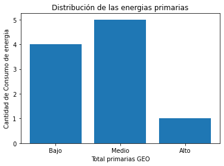

# ⚡ Energías renovables y cambio climático en Costa Rica (2010–2018)

**Proyecto final** del curso de Análisis de Datos de la Universidad Castro Carazo (2C-2022).

## Pregunta de negocio

> **¿Cómo se puede impactar positivamente el cambio climático a partir de las distintas energías que produce Costa Rica?**

El objetivo fue identificar las mejores alternativas, actuales y futuras, estudiando el consumo por sector, las fuentes de generación y las importaciones de energía.

## Datos

- **Fuente:** [SINAMECC](http://sinamecc.opendata.junar.com/dashboards/20735/datos-relacionados-a-cambio-climatico/), el Sistema Nacional de Métrica de Cambio Climático de Costa Rica. Son datos abiertos.
- **Unidad:** terajulios (TJ).
- **Contenido:** consumo de energía por sector y subsector (transporte, industria, residencial), centros de transformación, generación eléctrica por tipo de fuente, oferta interna e importaciones. Los archivos están en [`datos/`](datos).
- **Energías primarias analizadas:** hidroeléctrica (HE), geotérmica (GEO), eólica (EOL), biomasa (BIG) y solar (SOL).

## Proceso

| Etapa | Qué se hizo |
|---|---|
| **1. Carga** | Importación de los archivos de Excel con `pandas` y unión de los años 2010 y 2018 en un solo DataFrame. |
| **2. Valores faltantes** | Estandarización de `?` a `NaN`, conteo por columna, imputación (media y moda) y eliminación de las filas incompletas. |
| **3. Estandarización** | Revisión de tipos de datos, conversión de unidades y **normalización** de cada fuente (valor ÷ máximo) para poder compararlas. |
| **4. Binning** | Clasificación de cada fuente en niveles de consumo **bajo, medio y alto** con `pd.cut`. |
| **5. Visualización** | Histogramas, barras, gráficos circulares y de dispersión con `matplotlib`. |

## Resultados

- El **consumo final total pasó de 152,180 TJ (2010) a 176,935 TJ (2018)**, un **aumento del 16.3 %**. El crecimiento se acelera a partir de 2015.
- Las energías primarias, que en Costa Rica son principalmente renovables, muestran una **tendencia creciente**. Esto es coherente con los compromisos del **Acuerdo de París (2015)** sobre el uso de energías limpias.
- **Conclusión:** Costa Rica está bien posicionada en energías renovables y su uso crece cada año, pero el aumento de la demanda total exige seguir ampliando la generación limpia.

| Distribución del consumo por año | Geotérmica por nivel de consumo |
|---|---|
|  |  |

## Archivos

| Archivo | Contenido |
|---|---|
| [`energias_renovables_costa_rica.ipynb`](energias_renovables_costa_rica.ipynb) | Notebook completo, con código, tablas y gráficos. |
| [`datos/`](datos) | Datos originales de SINAMECC en Excel. |
| [`graficos/`](graficos) | Gráficos principales. `resumen_consumo_2010_2018.png` es un resumen hecho con los valores del notebook. |

**Herramientas:** Python · pandas · NumPy · matplotlib · Jupyter Notebook
